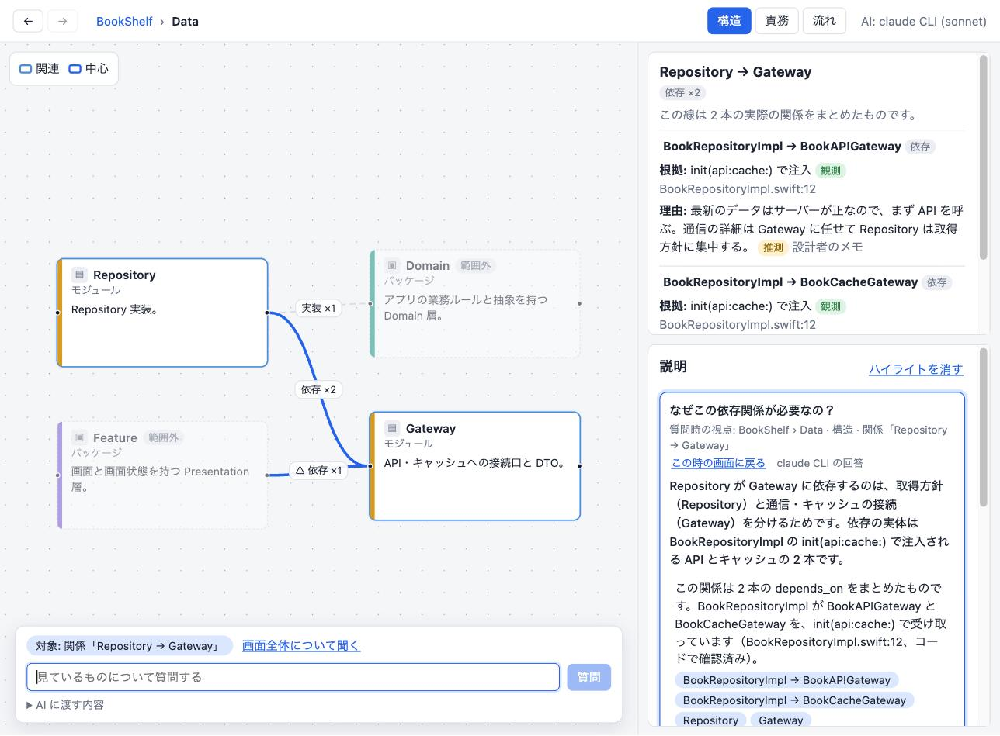
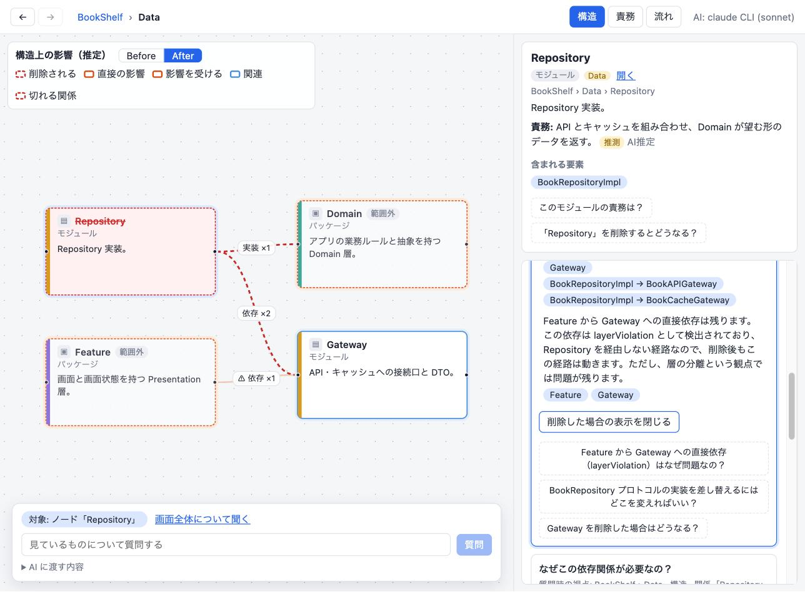

# Mental Model Explorer

A prototype interface for building a shared understanding of a software project between a human and an AI.
You explore the project as a graph — across abstraction levels and perspectives — and ask questions about
whatever you are looking at. The UI turns what you are looking at into structured context for the AI, and
the AI answers by pointing back into the same graph (highlights, what-if removal, traces).

人間とAIが、ソフトウェアプロジェクトについての理解（メンタルモデル）を同じ構造の上で一緒に組み立てるための
インターフェースのプロトタイプです。次の問いを、実際に操作して確かめるために作りました。

> 人間は、自分が見ているものをAIに説明し直すことなく、その対象について問いを立て、AIと一緒に理解を深められるか？

| 関係を選んで「なぜこの依存関係が必要なの？」 | 「Repositoryを削除するとどうなる？」の What-if |
| --- | --- |
|  |  |

## 使い方

ターミナルから起動します。AI の回答には、ログイン済みの [Claude Code](https://claude.com/claude-code) CLI
（`claude`）をヘッドレスモードで使います。課金は Claude のサブスクリプションに対して行われ、API キーは不要です。

```bash
git clone https://github.com/sei-lit/mental-model-explorer.git
cd mental-model-explorer
npm install
npm start            # ビルドして http://127.0.0.1:5178 を開く
```

| オプション | 内容 |
| --- | --- |
| `--project <path>` | 開く Gradle Kotlin プロジェクトのルート（既定は同梱のサンプル） |
| `--model <name>` | `claude` に渡すモデル（既定 `sonnet`。深く考えさせたいときは `opus`） |
| `--mock` | `claude` を使わず、グラフのデータから組み立てるモック応答で動かす |
| `--port <n>` | ポート（既定 5178） |
| `--claude <path>` | `claude` コマンドのパス |
| `--no-open` | ブラウザを開かない |

`npm start -- --mock` のように `--` の後ろに渡します。`claude` が見つからない場合は自動でモック応答になります。
開発時は `npm run dev`（Vite。`MME_MOCK=1` でモック）、テストは `npm test`。

## 自分のプロジェクトを開く

Gradle の Kotlin Multiplatform リポジトリを開けます。

```bash
npm start -- --project /path/to/kmp-repo      # 開発時は MME_PROJECT=/path/to/kmp-repo npm run dev
```

`settings.gradle.kts` があるディレクトリを指定します。読み取るのは次のものです。

- `include(":a:b")` のモジュール（`:tools:` 配下は除外）を、最初のセグメントごとのグループ（core / domain / data / feature / ui / access など）にまとめる
- 各モジュールの `build.gradle.kts` にある `projects.x.y` / `project(":x:y")` をモジュール間の依存にする
- `src/{commonMain,androidMain,iosMain,jvmMain,main}/kotlin` の `.kt` から、トップレベルの class / interface / object / enum と、そのメンバー（fun / val / var）を取り出す。supertype は implements、型の参照は依存にする。import・同一パッケージ・ワイルドカード import で一意に決まる名前だけをつなぐ
- ルートの `CLAUDE.md` に「モジュール構成」「依存の向き」の表があれば、責務と依存してよい範囲を取り込む。これらは**推測**として表示する

Kotlin の完全な構文解析はしていません（正規表現と簡易スキャナ）。iOS / Swift のプロジェクトには未対応です。

## できること

### Explore — 構造を探索する

- **Semantic Zoom**: ノードをダブルクリックすると、その内部に入ります（Project → Package → Module →
  Type → Method → Code）。入った先では、子要素どうしの依存がその粒度に持ち上げて表示され、外側の要素は
  「枝分かれした階層」の粒度で薄く表示されます。キャンバスのズームでもカードの情報量が変わります。
- **3 つの視点**: Structure（包含・依存）/ Responsibility（責務・役割・制約。観測か推測かを区別）/
  Flow（処理の流れを番号付きで）。視点を切り替えても、選択と抽象度はそのまま残ります。
- **関係を選ぶ**: エッジも選択でき、集約されたエッジは内訳（根拠・理由）を確認できます。層の向きに反する依存は ⚠ で示します。
- **探索の経路**: 戻る・進むと、パンくずで現在地を保ちます。

### Understand — AI と理解を組み立てる

- 何かを選んで質問欄に書くだけで、選択対象（ノード / 複数ノード / エッジ / コードの行範囲 / 画面全体）が
  質問の対象になります。「AI に渡す内容」を開くと、実際に送るコンテキストと、予算内に収めるために省いた件数を確認できます。
- 回答は文章と図が対応しています。文にカーソルを合わせると該当要素が強調され、参照チップを押すとその要素へ移動して探索を続けられます。
- 「削除するとどうなる？」には、影響範囲を UI 側で計算した Before / After を表示します（構造上の推定）。処理の流れは trace として番号付きで辿ります。
- 回答カードは質問したときの視点を覚えていて、「この時の画面に戻る」で戻れます。

## 設計

```
src/core/model          グラフ（包含は parentId、依存・呼び出しは葉同士のエッジ、主張は観測/推測を区別）
src/core/exploration    探索状態（scope = 抽象度、perspective、selection、履歴、trail）とビュー射影
src/core/understanding  質問コンテキストの構築、回答スキーマと検証、削除シミュレーション、モック応答
src/data                ProjectSource とサンプル（iOS の本棚アプリ）。将来のリポジトリ解析はここに足す
src/ui                  React + React Flow
server                  API（/api/project, /api/config, /api/ask）と claude CLI の呼び出し、起動用 CLI
```

### 「人間が注目しているもの」を AI にどう渡すか

UI の状態をそのまま送るのではなく、質問対象（subject）を中心に、次のものを予算内で抽出します。

| 軸 | 内容 |
| --- | --- |
| `target` / `subject` | 何について問うているか。エッジなら両端・根拠・理由、集約エッジなら relation 別の内訳と代表例（種類ごとに 1 例を先に選ぶ） |
| `lens` | 抽象度（どのノードの内部をどの粒度で見ているか）と視点、Flow なら手順 |
| `visible` | いま画面にある要素。多すぎるときは subject に接するものを優先 |
| `nearby` | 画面外だが subject と直接つながる要素（AI が名前を挙げられるように） |
| `trail` | そこに至るまでの探索を数文に圧縮（連続した選択は最後のものだけ） |
| `previous` | 直前の回答（追い質問のため） |
| `omitted` | 省いた件数。UI にも表示する |

### AI の回答を UI に反映するときの安全性

- 回答は構造化データ（`answerSchema`）で受け取り、モデルが返すのはノード / エッジの ID と宣言的な
  visual（`whatIfRemove` / `trace`）だけです。影響範囲の計算と描画は UI が行い、モデルの出力を実行しません。
- サーバーで ID の実在を検証し、存在しない参照は除外して画面に件数を表示します。visual は一部でも不正なら丸ごと捨てます。
- `claude` はツールを無効化し、空の一時ディレクトリで起動します（CLAUDE.md などに影響されないように）。
  サーバーは 127.0.0.1 にだけ bind し、ほかのサイトや DNS rebinding からの API 呼び出し（サブスクリプションを
  勝手に消費される）を防ぐため、Host / Origin が自分自身のリクエストだけを受け付けます。

## スコープ外

理解度の評価、メンタルモデルの永続化、ソースコードの編集、GitHub リポジトリの自動解析、複数人での同時編集、認証。

## License

MIT
